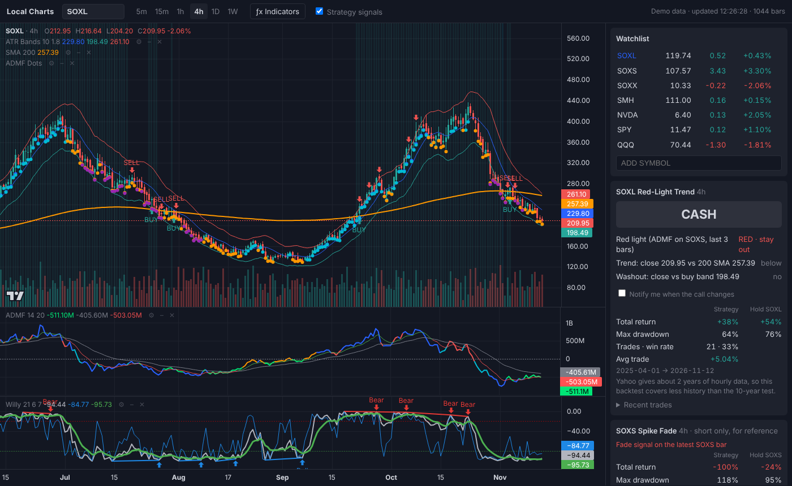

# Local Charts

A small TradingView-style charting app that runs on your own computer. It pulls live and historical
prices from Yahoo Finance, draws candlestick charts with indicators you can add, remove and configure,
and runs the SOXL Red-Light Trend strategy.

## Start it

- **Mac:** double-click `Start (Mac).command` (the first time, right-click it and choose Open). If macOS
  says it can't be opened, run `chmod +x "Start (Mac).command"` once in Terminal from this folder.
- **Windows:** double-click `Start (Windows).bat`
- **Any OS:** `pip install -r requirements.txt` then `python app.py`

It opens http://127.0.0.1:8765 in your browser. Keep the terminal window open while you use it.
You need Python 3.9 or newer from [python.org](https://www.python.org/downloads/).
To try it without internet: `python app.py --demo`.

## What it does

- Candles on 5m, 15m, 1h, 4h, 1D and 1W. The 4h bars are built from 1h bars the same way TradingView
  builds them (9:30–13:30 and 13:30–16:00 ET).
- **ƒx Indicators** button: add, hide, remove and change the settings of indicators. Each one gets its
  own pane when it needs one, just like TradingView. Your setup is remembered in the browser.
  - Ports of the TradingView scripts you use: **ATR Bands + %R flags**, **ADMF Divergence** (HIST colored red / orange /
    lime / aqua / blue by divergence type), **ADMF Structure Dots** (HH/HL/LH/LL) and
    **Willy %R Divergences**
  - Built-ins: Volume, SMA, EMA, Bollinger Bands, RSI, MACD
- Watchlist with live prices (refreshes every 30 seconds).
- **SOXL ADMF Pivot** panel (1h, the main strategy): the current call (HOLD SOXL / CASH) from the last
  finished 1h bar, why, a warning when the bar still forming shows a signal, a backtest against holding
  SOXL and against Red-Light Trend over the same dates, recent trades, and an optional browser
  notification when the call changes. Its BUY/SELL markers show on the SOXL 1h chart.
- **SOXL Red-Light Trend** panel (4h, the previous rule), kept for comparison.
- **SOXS Spike Fade** panel, for reference (it needs shorting).

## SOXL ADMF Pivot

Hold SOXL by default. When a 1h bar closes with the ADMF Divergence color **red** on SOXS or on SOXL,
go to cash for the next 4 bars (a new red restarts the count). If SOXL turns **aqua** or SOXS turns
**orange** in that time, buy back early. Signals are read at a bar's close and filled at the next bar's
open, with 0.05% cost per side.

Why these colors: on 1h bars, SOXL fell on average over the next 8–32 hours after SOXS red or SOXL red,
and rose after SOXL aqua or SOXS orange, by similar amounts in 2025 and in 2026. The settings were chosen on
2025 data only and then tested on 2026, which they had not seen:

| 2026 (unseen) | Return | Max drawdown | Trades |
| --- | --- | --- | --- |
| ADMF Pivot (1h) | about +480% | 51% | 73 |
| Red-Light Trend (4h) | +166% | 67% | 15 |
| Hold SOXL | +41% | 85% | 1 |

Things to know before trading it:

- **Act within about an hour.** Signals 1–2 bars late still beat holding, but signals 8+ hours old are worth nothing.
- **It depends on the ADMF defaults** (length 14, lookback 20). Nearby settings test noticeably worse.
- **Only 2 years of history.** Yahoo keeps about 2 years of 1h bars, so the test covers one up-year and one
  choppy year. Drawdowns of about 50% still happened.
- **A few trades make most of the money.** Without its 10 best trades of 73, 2026 would have been a loss.
  Missing one signal can matter a lot.
- Yahoo's volume can differ from TradingView's, so ADMF colors here can differ from your TradingView chart on some bars.

## Adding your own indicator

Open `static/registry.js` and add an entry. Each entry lists its settings and a `compute(bars, params)`
function that returns lines, histograms, horizontal levels, markers or straight-line segments. The math
helpers in `static/indicators.js` (`Ind.sma`, `Ind.ema`, `Ind.rma`, `Ind.atr`, `Ind.wpr`, `Ind.rsi`,
`Ind.pivot`, `Ind.valuewhen`, ...) behave like their Pine `ta.*` versions.

## Saved price history

Closed bars (everything from before today, New York time) are saved in the `cache/` folder, one CSV
per symbol and timeframe. The first time you open a symbol, the app downloads its full history. After that,
including after a restart, it asks Yahoo only for the bars since the last saved one, and saves new bars
once they close. Bars still forming today stay in memory and refresh every 20 seconds.

- If a split changes past prices, the app sees that the saved closes no longer match Yahoo's, downloads
  the full history again and replaces the saved file.
- Saved 5m/15m/1h bars are kept after Yahoo's 60-day / 2-year window, so intraday history keeps
  growing while you use the app (unless the app goes unused for longer than that window).
- If Yahoo can't be reached, the app shows the saved bars.
- Delete the `cache/` folder to force a full re-download.

## Limits

- Yahoo keeps about 60 days of 5m/15m bars and about 2 years of 1h bars, so 4h charts and the
  backtest cover about 2 years. Daily and weekly go back to each fund's start.
- Yahoo prices can lag by a few minutes, and this polls every 30 seconds rather than streaming.
- Yahoo's volume can differ slightly from TradingView's, which can move ADMF colors on some bars.

## Files

| Path | What it is |
| --- | --- |
| `app.py` | Data server: downloads from Yahoo, saves closed bars to `cache/`, builds 4h bars |
| `static/indicators.js` | Indicator math, including the ports of your Pine scripts |
| `static/registry.js` | Indicator catalog: settings and what each one draws |
| `static/strategies.js` | SOXL ADMF Pivot, SOXL Red-Light Trend and SOXS Spike Fade |
| `static/app.js` | Panes, legends, indicator dialogs, watchlist, strategy panel |
| `pine/` | The two TradingView strategy scripts |

Charts use [TradingView Lightweight Charts](https://www.tradingview.com/lightweight-charts/)
(Apache 2.0, see `static/vendor`). The indicator ports are under MPL 2.0 (see `static/indicators.js`).
Not financial advice.
